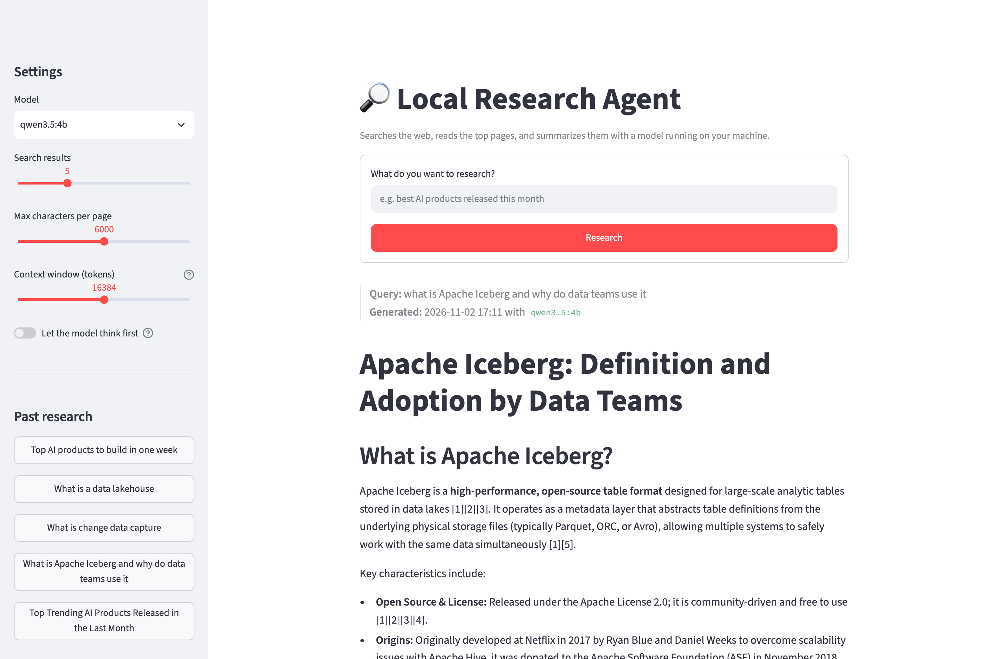
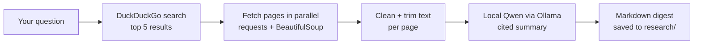

# 🔎 Local Research Agent

A personal web research agent that **searches the web, reads the top pages, and writes a cited Markdown digest using an LLM running on your own machine.** It comes with a simple web UI and a CLI.

No paid APIs and no API keys: search uses DuckDuckGo, and summarizing runs locally with [Ollama](https://ollama.com) + [Qwen 3.5](https://ollama.com/library/qwen3.5).

> Built on top of Darsh Shah's freeCodeCamp tutorial
> **[How to Build a Personal Web Research AI Agent with Ollama and Qwen](https://www.freecodecamp.org/news/build-a-personal-ai-web-research-agent-with-ollama-and-qwen/)**.
> The version I replicated from the article lives in [`tutorial/research_agent_original.py`](tutorial/research_agent_original.py) for comparison.



## How it works



## What's different from the tutorial

| Tutorial | This repo | Why |
| --- | --- | --- |
| Ollama web search API | **DuckDuckGo** (`ddgs`) | Ollama's web search asked for paid usage credits on my account; DuckDuckGo is free and keyless |
| Full pages dumped as JSON | **Trimmed plain-text** sources | Five full pages overflow a small model's context, and JSON wastes tokens |
| Ollama's default context window | **`num_ctx` = 16K** (configurable) | Ollama silently truncates long prompts, so the model may only see part of the sources |
| No citations | **Inline `[1]` citations + real sources list** | Small models hallucinate; citations make spot-checking quick |
| No User-Agent, failures hidden | **Browser User-Agent, skipped pages reported** | Many sites block bare `requests`; you can see what was actually read |
| Pages fetched one by one | **Parallel fetching** | Faster |
| Thinking on (model default) | **Thinking off by default**, toggle to enable | Much faster for summarizing |
| Terminal only | **Streamlit web UI** + CLI | Live progress, streamed output, history, download |

## Requirements

- **[Ollama](https://ollama.com/download)**, installed and running
- **Python 3.10+**. On macOS, don't use the system Python 3.9: it's built against an old LibreSSL that `ddgs` can't use (`ValueError: Unsupported protocol version 0x304`). Use `brew install python@3.12`.
- About 8 GB of RAM for the default `qwen3.5:4b` model (developed on a 16 GB MacBook M4 Pro)

## Setup

```bash
git clone https://github.com/shreshtha-132/local-research-agent.git
cd local-research-agent

ollama pull qwen3.5:4b

python3.12 -m venv venv
source venv/bin/activate
pip install -r requirements.txt
```

## Usage

### Web UI

```bash
streamlit run app.py
```

This opens http://localhost:8501. Type a question, watch the pages being read, and the digest streams in. Every report is saved to `research/` with a readable name (e.g. `What is Apache Iceberg - 2 Nov 2026, 5.11 PM.md`) and listed in the sidebar. The sidebar also has settings for the model, number of results, text per page, context size and thinking.

### CLI

```bash
python research_agent.py "what is Apache Iceberg and why do data teams use it"
python research_agent.py --model qwen3.5:9b --results 8 "open-source LLM releases this month"
python research_agent.py --help
```

## Choosing a model

| RAM | Suggested model |
| --- | --- |
| 8 GB | `qwen3.5:0.8b` (fast, noticeably weaker) |
| 16 GB | `qwen3.5:4b` (default), or `qwen3.5:9b` for better quality at lower speed |
| 32 GB+ | Larger models from the [Ollama library](https://ollama.com/library) |

Any model you've pulled with `ollama pull` appears in the UI's model dropdown.

## Limitations

- **Spot-check before trusting a digest.** Local models are small and can still mix up or invent details, even with citations.
- Pages that need JavaScript, or that block scrapers, are skipped. The agent falls back to the search snippet and marks the source *(snippet only)*.
- DuckDuckGo may rate-limit you if you send many queries in a row.
- Privacy: summarizing is local, but your search query goes to DuckDuckGo and pages are fetched from their sites.

## Roadmap

- [ ] Agentic mode: give the model `search` / `fetch` as tools so it decides what to look up and when it has enough
- [ ] Scheduled daily digests (e.g. "AI news today") via cron or launchd
- [ ] Pluggable search backends (Brave, Tavily, SearXNG)

Ideas and PRs welcome.

## License

[MIT](LICENSE)
